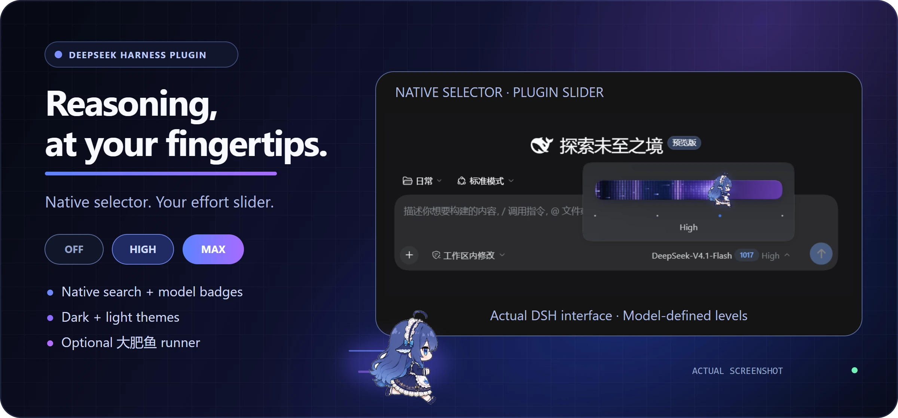
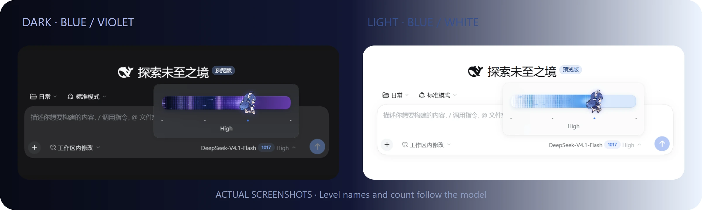
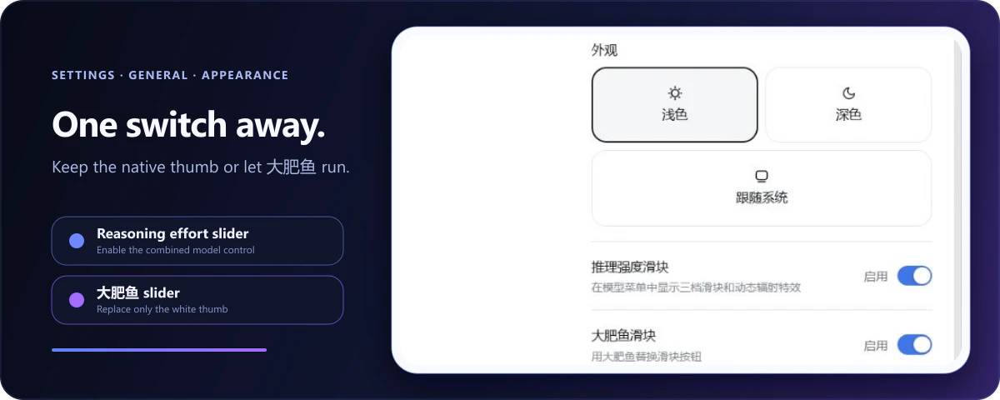

<div align="center">



# dsh-reasoning-effort

**A Codex-style model and reasoning-effort control, built directly into DeepSeek Harness.**

[中文首页](README.md) · [Latest release](https://github.com/HanaAyane/dsh-reasoning-effort/releases/latest) · [Report an issue](https://github.com/HanaAyane/dsh-reasoning-effort/issues)

[](https://github.com/HanaAyane/dsh-reasoning-effort/releases/tag/v0.8.2)
[](#version-support-policy)
[](LICENSE)
[](https://github.com/HanaAyane/dsh-reasoning-effort/releases)

</div>

Switch models and adjust reasoning effort below the DSH composer, with an eight-frame Big Fat Fish runner that speeds up as you drag. Levels come from the selected model, and selections stay synchronized with `/model`.

- **Model-defined levels** — adapts to their count, names, and order; failed updates roll back.
- **Native appearance** — dark and light themes, with Simplified Chinese and English following DSH's active language immediately.
- **Optional motion** — the runner is on by default, with a plain-thumb option and reduced-motion support.
- **Custom-model guidance** — copy a configuration snippet, or one-click copy a whole brief for an agent to diagnose and fill in.



[What changed](#whats-new-in-v081) · [Install and update](#install-and-update) · [Desktop installation](#install-in-dsh-desktop) · [Version support](#version-support-policy) · [Appearance](#the-big-fat-fish-slider) · [Troubleshooting](#troubleshooting)

## What's new in v0.8.2

- Adapt to DSH `0.2.1-rc.2` and hide the unavailable model selector in addressed subagent sessions.
- Refresh guidance after configuration changes and discard stale results.
- Respect disabled reasoning and existing valid levels instead of flagging knowledge-base differences.
- Follow the composer's compact display and document the native reasoning-level editor.

See the [v0.8.2 release notes](https://github.com/HanaAyane/dsh-reasoning-effort/releases/tag/v0.8.2) and [CHANGELOG](CHANGELOG.md) for details.

## Native selector integration (in development)

This branch wraps the DSH native model selector at plugin runtime, preserving native model search and badges while connecting the effort entry to the plugin slider. Models without effort levels also expose the configuration guide here. No host files are modified; disabling the plugin or slider restores the native component. This adapter targets the DSH 0.2.1-rc.2 component structure and needs revalidation after host upgrades.

## Version support policy

This plugin targets relatively stable **DSH RC versions** for compatibility work, testing, and bug fixes. **Individual alpha versions are not maintained.** During alpha development, client APIs, dependencies, and plugin loading may undergo frequent breaking changes. Supporting multiple transitional versions increases maintenance costs and makes compatibility difficult to sustain.

The current release is **plugin `v0.8.2`**. It requires DSH `0.2.1-rc.2` or newer for Web and Desktop profiles. DSH `0.2.0` RC users should remain on [v0.8.1](https://github.com/HanaAyane/dsh-reasoning-effort/releases/tag/v0.8.1). Desktop renders DSH's Web client but keeps separate plugin installation and activation state. For DSH `0.1.x`, continue using [v0.7.3](https://github.com/HanaAyane/dsh-reasoning-effort/releases/tag/v0.7.3). RC means release candidate; it does not imply automatic compatibility with every past or future RC.

| Item | Current status |
| --- | --- |
| Plugin release | [v0.8.2](https://github.com/HanaAyane/dsh-reasoning-effort/releases/tag/v0.8.2) |
| Web | DSH `0.2.1-rc.2` or newer; use the `web` profile |
| Desktop | DSH Desktop `0.2.1-rc.2`; use the `desktop` profile |
| Upgrade notes | Install `v0.8.2`, then restart the corresponding Web Host or desktop app |
| Alpha versions | No separate adaptations; patch locally or switch to the target RC |

## Install and update

The download badge above automatically shows total downloads of all release assets, with a cache delay. Only uploaded assets (such as plugin packages and checksum files) are counted. Repeat downloads count separately; these figures are not plugin installation counts or unique users and exclude GitHub-generated source ZIP/TAR downloads and Git clones.

### Web: install a pinned release

Run these commands in the terminal environment you use to start DSH:

```powershell
dsh plugin --profile web add github:HanaAyane/dsh-reasoning-effort#v0.8.2
dsh --profile web --dump-config
```

Confirm that the output includes `name: dsh-reasoning-effort`. Use the same `add` command to update an existing installation. To try development changes, replace `#v0.8.2` with `#main`; the main branch may contain unreleased changes.

You can also [download the v0.8.2 package](https://github.com/HanaAyane/dsh-reasoning-effort/releases/download/v0.8.2/dsh-reasoning-effort-0.8.2.tgz).

<details>
<summary>Ask an agent to install it: copy this prompt</summary>

```text
Install dsh-reasoning-effort v0.8.2 for the DeepSeek Harness web profile.
Run only these two commands and do not change any other profile:
dsh plugin --profile web add github:HanaAyane/dsh-reasoning-effort#v0.8.2
dsh --profile web --dump-config
Confirm that dsh-reasoning-effort appears in the configuration and report the result.
Do not stop or restart the running DSH process. Remind me to restart the Web Host and refresh the page manually.
```

</details>

### Web: restart and refresh

The plugin loads when the Web Host starts. After installation, restart the DSH Web Host manually and refresh the page.

### Choose a model and effort level

Open a session and click the model control below the composer. Drag the thumb or click the track; release to snap to the nearest valid level. Click the model row below it to expand the model list.

### Install in DSH Desktop

For **DSH Desktop `0.2.1-rc.2`**, install inside the desktop app. No terminal command registration or prior app exit is required.

1. Open DSH Desktop and select **Plugins** in the sidebar.
2. Choose **Add plugin** and enter this in **Package name or address**:

   ```text
   github:HanaAyane/dsh-reasoning-effort#v0.8.2
   ```

   Enter the package address, not a `dsh plugin ...` command.
3. Wait for the plugin information to load, verify the source and version, and install.
4. Confirm that `dsh-reasoning-effort` is enabled under **Installed plugins**, then reload or restart as directed.

If installing from the GitHub repository fails, you can also enter the prebuilt release package URL in **Package name or address**:

```text
https://github.com/HanaAyane/dsh-reasoning-effort/releases/download/v0.8.2/dsh-reasoning-effort-0.8.2.tgz
```

Desktop uses its own `desktop` profile; plugins installed in the `web` profile do not carry over. If the terminal reports `profile "desktop" is managed exclusively by the Electron application`, that CLI is not allowed to manage the Desktop profile. Use the in-app installer above instead of changing the profile name or bypassing the restriction. See the [official Desktop documentation](https://github.com/deepseek-ai/deepseek-harness/blob/dsh-v0.2.1-rc.2/apps/desktop/README.md#installation-ownership).

## Where the levels come from

The slider reads `reasoning.efforts` from the current model in DSH's model directory. The model and route determine the count, names, and order. Levels are not fixed to three steps and can differ between endpoints.

The slider appears when at least two levels are available; otherwise the menu shows a notice. DSH validates and dispatches the selected value, so the plugin cannot bypass model or deployment limits.

## Declaring levels for any custom model

This section is vendor-neutral and applies to every model you declare yourself under `llm-pi-ai`.

**Why the levels are missing**: DSH's model directory only reports what the adapter declares. Custom models without inherited catalog metadata need explicit `reasoningEfforts` to expose levels. Missing directory levels do not prove the endpoint cannot reason.

**What to write**: open the configuration file shown in the guidance panel (the target profile's `cordis.patch.yml`). Add `reasoningEfforts` under the model's `llm-pi-ai` entry, matching its existing indentation. Each key is a DSH level, each value is the spelling the endpoint accepts, and a level left out counts as unsupported:

```yaml
models:
  - id: <your model id>
    reasoningEfforts:
      low: "<value the endpoint accepts>"
      high: "<value the endpoint accepts>"
```

**When to add `compat`** (beside `reasoningEfforts`, only when the endpoint needs it):

| Endpoint behaviour | What to add |
| --- | --- |
| expresses effort directly through `reasoning_effort` | nothing |
| needs its thinking switch turned on first | `compat.thinkingFormat`: `"qwen"` (sends `enable_thinking`) / `"zai"` / `"deepseek"` |
| does not accept `reasoning_effort` | `compat.supportsReasoningEffort: false` |
| fails with 400 `invalid_parameter_error` | `compat.supportsDeveloperRole: false` |
| fails while replaying history | `compat.requiresReasoningContentOnAssistantMessages: true` |
| does not reason at all | `reasoningEfforts: false` |

With no `compat`, the adapter decides from the endpoint address: an address it does not recognize is treated as standard OpenAI, and a recognized vendor endpoint gets that vendor's format automatically. **Guessing the format is worse than leaving it out.**

**How to verify**: check configuration parsing and directory levels after saving, then validate actual requests. A visible slider establishes metadata only, not endpoint acceptance or effective strength changes. Built-in knowledge entries are references, not a requirement.

## Composer text size

Custom CSS can override the model name and effort font size and line height. Defaults remain `12px` and `1`. For example:

```css
.re-model-root {
  --re-composer-font-size: 13px;
  --re-composer-line-height: 18px;
}
```

This is a CSS override hook, not a plugin setting. The button is 28px tall with a maximum width of 230px; check long model names and narrow windows after increasing text size.

## Effort guidance for custom providers

DSH `0.2.1-rc.2` can configure custom API levels and wire values directly in **Settings → Models → Edit provider → Customized settings → Model options (›) → Reasoning levels**. The YAML guidance below remains available for advanced configuration.

Built-in routes get their levels from the pi-ai catalog and the plugin never touches them. Only models you declare yourself in `llm-pi-ai` receive guidance:

1. Open the model menu. If the current model is your own declaration, the directory exposes no levels, and `reasoningEfforts` is not explicitly `false`, the menu shows the graphical Settings path first, with manual guidance under **Advanced configuration**. Existing valid levels are trusted even when they differ from the knowledge base.
2. Prefer the Settings path at the top of the panel. For manual editing, expand **Advanced configuration** to see YAML indented for the active configuration file, its path, and the model entry location.
3. Follow the panel's replace or insert instruction for the matching `- id:` entry, preserve other configuration, and save. DSH reloads automatically; if not, restart the Web Host and refresh.

Models the knowledge base does not know get a generic template you can edit directly. When a gateway rejects requests for a reason the template cannot express — an endpoint refusing the `developer` message role, for instance — the panel names the matching `compat` switch (`supportsDeveloperRole: false`).

Press **Copy for your agent** to configure missing levels, adjust existing ones, or diagnose failures. Models you declare retain this entry even when valid levels already exist. The copied brief includes the route, model ID, actual configuration path, entry location, directory levels, and vendor-neutral declaration rules. It excludes built-in knowledge-base level presets and compat recommendations.

Paste the prompt into your coding agent. It reads the actual route's `api` / `baseURL`, checks the endpoint's official documentation, distinguishes effort enums, thinking switches, token budgets, and aliases, and makes a minimal model-entry change. It asks for missing evidence or provides a patch when file access is unavailable. The prompt requires preserving existing configuration and reporting configuration parsing, directory metadata, and actual-request validation separately.

<details>
<summary>Advanced: extend the plugin knowledge base</summary>

The built-in entries cover only a few models, purely to save typing. Add `entries` under `config` in the existing `id: reasoning-effort` profile row. This example shows relative content; keep the indentation of the containing row. User entries win over built-ins:

```yaml
entries:
  - id: my-model
    provider: "*"          # provider route, * wildcard
    model: "my-model-id"   # model id, * wildcard
    note: description
    efforts:               # display level -> wire value the endpoint accepts
      low: "low"
      high: "high"
      max: "max"
    # compat:              # only when the endpoint needs a fixed format
    #   thinkingFormat: "qwen"
    #   supportsReasoningEffort: false
```

A `compat` block is copied into the generated snippet **verbatim**, so fill it in only when the endpoint really needs a fixed format: with none, the adapter decides from the endpoint address (an unrecognized address is treated as standard OpenAI, a recognized vendor gets that vendor's format), and a wrong format overrides that correct decision. On a protocol that does not take the field (e.g. `anthropic-messages`) the pasted entry makes the whole route fail to resolve.

The plugin only provides snippets — it never writes configuration, and catalog-declared level sets (even a single level) are never flagged.

</details>

## The Big Fat Fish slider

The eight-frame runner is **enabled by default**. To switch back to the plain white thumb:

1. Open **Settings → General**.
2. Find **Big Fat Fish slider** below Appearance.
3. Disable it and return to the model control.



The runner changes only the thumb artwork. Snapping, keyboard control, radiation effects, and model selection remain unchanged. It animates faster while dragging and freezes on a stable frame when reduced motion is enabled.

The **Reasoning effort selector** switch on the same page disables the complete enhancement without uninstalling it. DSH's built-in model selector returns immediately. Both preferences stay in the current browser.

## Troubleshooting

### The slider does not appear

Check that:

1. Check that the running version matches the support table above; Desktop shows its version under **About DeepSeek Harness**.
2. You restarted the corresponding Web Host or fully quit and reopened the desktop app after installation.
3. **Settings → General → Reasoning effort selector** is enabled.
4. The selected model exposes at least two effort levels in the DSH model directory (see the next entry for models without any), and thinking is not disabled by the deployment.

### A model declares no effort levels

First check **Advanced configuration** in the model menu. For manual configuration, use the file path shown in the panel and the current model and endpoint documentation to fill in that entry's `reasoningEfforts` and `compat`. Do not reuse another model's levels or context limits without checking them.

The knowledge base provides guidance; the endpoint determines accepted values. If saving does not take effect, restart the Web Host and refresh the page.

### Report a problem on an RC version

Open an [issue](https://github.com/HanaAyane/dsh-reasoning-effort/issues) with your DSH version, plugin version, client type (Web or desktop wrapper), reproduction steps, and relevant console errors. Remove tokens and credentials before posting.

### Confirm that the plugin loaded

```powershell
dsh --profile web --dump-config
```

The Web output should contain `name: dsh-reasoning-effort`. For Desktop, fully quit the app, then run `dsh plugin --profile desktop list` with its bundled command and confirm that the plugin appears.

### Uninstall

```powershell
dsh plugin --profile web remove dsh-reasoning-effort
```

For Desktop, fully quit the app, then run `dsh plugin --profile desktop remove dsh-reasoning-effort` with its bundled command. Restart the corresponding Web Host or desktop app afterward; the native model selector will return automatically.

## Development

```powershell
pnpm install
pnpm run check
pnpm pack
```

Use Node.js `22.19+` (also meeting the target DSH requirements) and `pnpm@11.7.0`. `pnpm run check` validates TypeScript and locale dictionaries, then rebuilds the host entry, browser module, and type declarations. See [design/visual-spec.md](design/visual-spec.md) for the complete interaction contract and [SECURITY.md](SECURITY.md) for vulnerability reporting.

## License

[MIT](LICENSE) © HanaAyane
