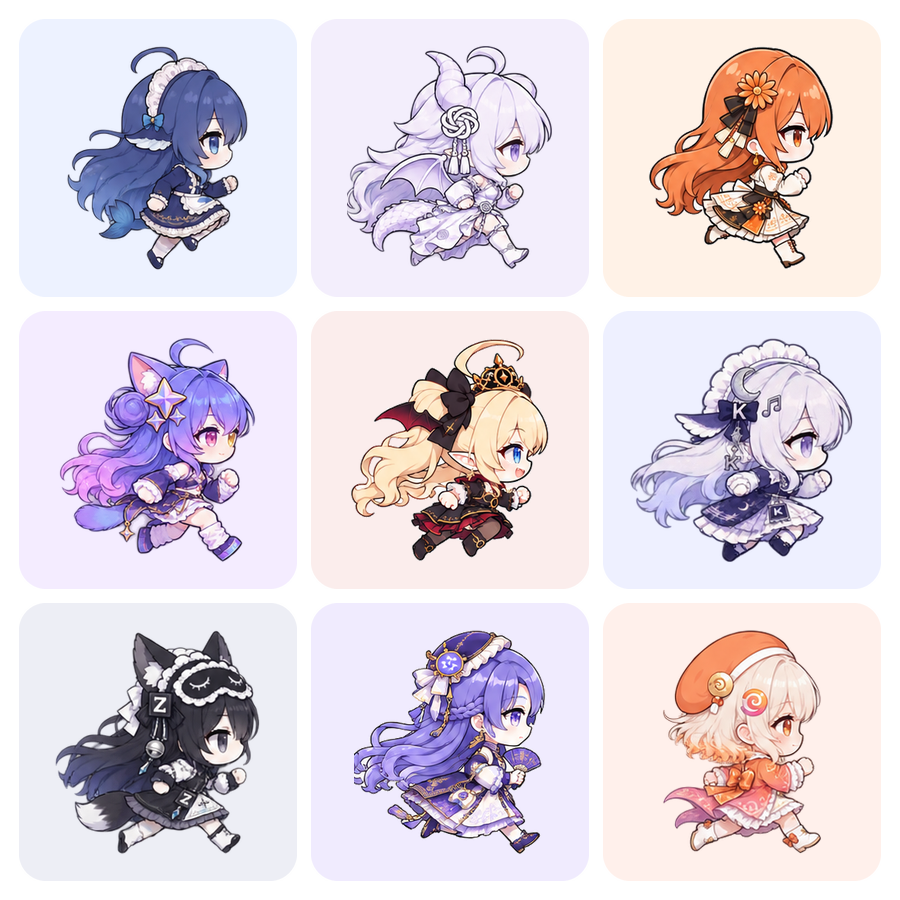
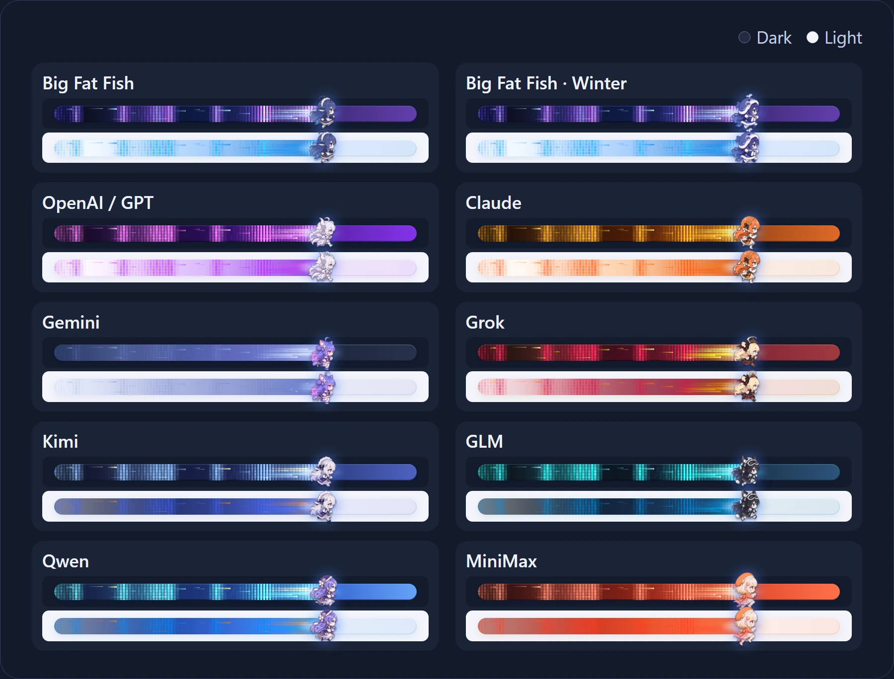
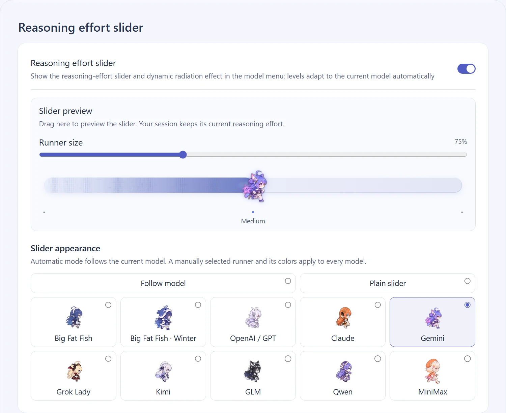

<p align="center">
  
</p>

# dsh-reasoning-effort 1.0.0

Drag to adjust reasoning effort inside **DeepSeek Harness**’s native model menu. Version 1.0.0 adds **10 runners across 9 model families** and a dedicated settings page with a draggable preview.

[中文](README.md) · [Install](#install-and-update) · [npm](https://www.npmjs.com/package/@ayanehana/dsh-reasoning-effort) · [Releases](https://github.com/HanaAyane/dsh-reasoning-effort/releases) · [Report an issue](https://github.com/HanaAyane/dsh-reasoning-effort/issues)

[](https://www.npmjs.com/package/@ayanehana/dsh-reasoning-effort) [)](https://www.npmjs.com/package/@ayanehana/dsh-reasoning-effort)

## Runners and tracks

<p align="center">
  
</p>



Choose Big Fat Fish, its winter outfit, or a runner for OpenAI, Claude, Gemini, Grok, Kimi, GLM, Qwen, or MiniMax. Each runner has a **16-frame** animation that speeds up as you drag. The track and trail take on the selected runner’s colors.

## Install and update

### Desktop

Open **Plugins → Add plugin → Package name or address**, enter the package below, and reload when prompted.

```text
@ayanehana/dsh-reasoning-effort@1.0.0
```

### Web

```powershell
dsh plugin --profile web add @ayanehana/dsh-reasoning-effort@1.0.0
```

Restart the DSH Web Host and refresh the page after installation.

## Adjust reasoning effort

Click the current model below the composer and open **Effort**. Drag or click the slider to choose a level the model supports. Press `Esc` to return to the model menu. DSH still provides search, groups, and the Agent Teams toggle. When you switch back to a model, the plugin restores the last confirmed level if it is still supported.

## Customize the slider

Open **Settings → Reasoning effort slider** to follow the active model, choose a fixed runner, or use a plain slider. Runner size ranges from **50% to 125%**, with 50% as the default. Drag the preview to try the effects while your session keeps its current effort.



## Compatibility and custom models

- Compatibility maintenance targets DSH RC builds. The native menu integration targets **DSH 0.2.2-rc.2**.
- If a custom model has no effort levels, open **Settings → Models → Edit provider → Customized settings → Model options → Reasoning levels** and use the values from the endpoint’s API documentation.

Thanks to @xihucuyudaichi for contributing the original set of model runners. [PR #9](https://github.com/HanaAyane/dsh-reasoning-effort/pull/9)

[Changelog](CHANGELOG.md) · [Contributing](CONTRIBUTING.md) · [MIT license](LICENSE)
