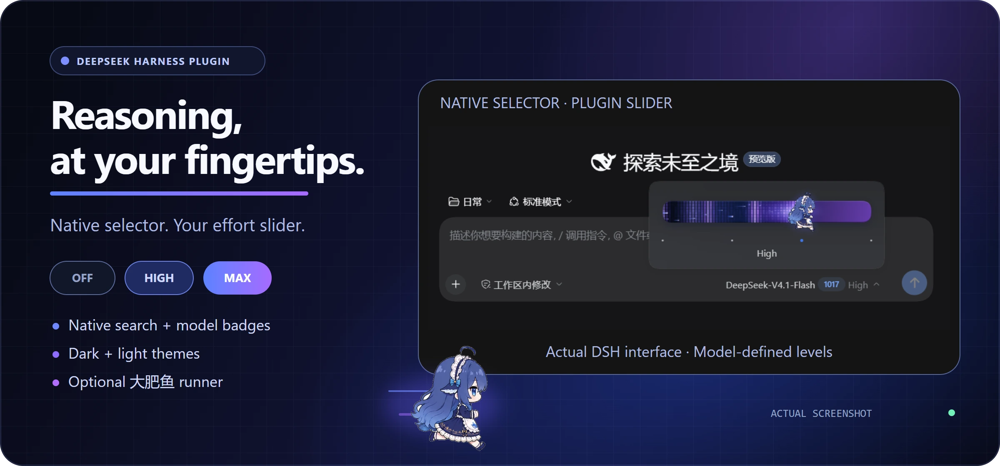
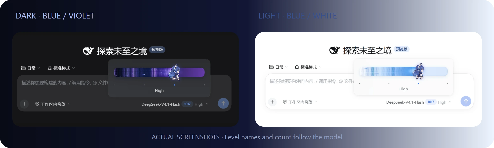
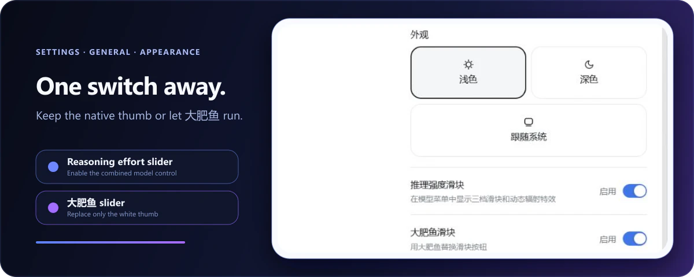

<div align="center">



# dsh-reasoning-effort

**DSH’s native model selector, with a reasoning-effort slider inside its Effort entry.**

[中文首页](README.md) · [npm](https://www.npmjs.com/package/@ayanehana/dsh-reasoning-effort) · [Latest release](https://github.com/HanaAyane/dsh-reasoning-effort/releases/latest) · [Report an issue](https://github.com/HanaAyane/dsh-reasoning-effort/issues)

[](https://github.com/HanaAyane/dsh-reasoning-effort/releases/tag/v0.9.2)
[](#version-support-policy)
[](LICENSE)
[](https://github.com/HanaAyane/dsh-reasoning-effort/releases)
[](https://www.npmjs.com/package/@ayanehana/dsh-reasoning-effort)

</div>

Keep native model search, groups, and badges. Open Effort to adjust the plugin slider with level markers and a visible level name. The eight-frame Big Fat Fish runner speeds up as you drag; the menu stays open after adjustment and selections stay synchronized with `/model`.

- **Model-defined levels** — adapts to their count, names, and order; failed updates roll back.
- **Native appearance** — dark and light themes, with Simplified Chinese and English following DSH's active language immediately.
- **Optional motion** — the runner is on by default, with a plain-thumb option and reduced-motion support.
- **Guidance when needed** — prefer graphical Settings for missing levels; manual steps and copy actions stay under Advanced configuration. Valid levels need no tutorial.



[What changed](#whats-new-in-v092) · [Install and update](#install-and-update) · [Desktop installation](#install-in-dsh-desktop) · [Version support](#version-support-policy) · [Appearance](#the-big-fat-fish-slider) · [Troubleshooting](#troubleshooting)

## What's new in v0.9.2

`v0.9.2` is an interaction performance and bug-fix update ahead of the next major update. Slider effects settle smoothly on release, and the reasoning pane opens at the correct position. Models with one configured effort and a separate default can use both slider stops, and the selector remembers each model's last confirmed effort.

The next major update will bring character-themed sliders to more model families.

`v0.9.2` is available on GitHub. See the full list of changes in the [v0.9.2 Release](https://github.com/HanaAyane/dsh-reasoning-effort/releases/tag/v0.9.2) and [CHANGELOG](CHANGELOG.md).

## Version support policy

Plugin **`v0.9.2` is compatible with DSH `0.2.2-rc.1`** on Web and Desktop. Maintenance targets RC versions.

## Install and update

The download badges separately show total downloads of GitHub release assets and npm package downloads over the last month, with a cache delay. For a newly published npm package, the badge may temporarily show `package not found or too new` until download statistics become available, then update automatically. Repeat downloads count separately; these figures are not plugin installation counts or unique users. GitHub statistics exclude npm downloads, GitHub-generated source ZIP/TAR downloads, and Git clones.

### Web: install a pinned release

GitHub provides the [v0.9.2 plugin package](https://github.com/HanaAyane/dsh-reasoning-effort/releases/download/v0.9.2/dsh-reasoning-effort-0.9.2.tgz). npm currently provides `@ayanehana/dsh-reasoning-effort@0.9.1`. The unscoped package belongs to another maintainer. [npm package page](https://www.npmjs.com/package/@ayanehana/dsh-reasoning-effort)

If you previously installed the old `dsh-reasoning-effort` package from GitHub, uninstall it before switching to the scoped package to avoid loading both copies. For Web, run `dsh plugin --profile web remove dsh-reasoning-effort`; for Desktop, uninstall it from the **Plugins** page.

Run these commands in the terminal environment you use to start DSH:

```powershell
dsh plugin --profile web add https://github.com/HanaAyane/dsh-reasoning-effort/releases/download/v0.9.2/dsh-reasoning-effort-0.9.2.tgz
dsh --profile web --dump-config
```

Confirm that the output includes `name: '@ayanehana/dsh-reasoning-effort'` (quoting may vary).

You can also install from the GitHub tag `github:HanaAyane/dsh-reasoning-effort#v0.9.2`. To try development changes, use `#main`, which may contain unreleased changes.

<details>
<summary>Ask an agent to install it: copy this prompt</summary>

```text
Install dsh-reasoning-effort v0.9.2 for the DeepSeek Harness web profile.
Run only these two commands and do not change any other profile:
dsh plugin --profile web add https://github.com/HanaAyane/dsh-reasoning-effort/releases/download/v0.9.2/dsh-reasoning-effort-0.9.2.tgz
dsh --profile web --dump-config
Confirm that dsh-reasoning-effort appears in the configuration and report the result.
Do not stop or restart the running DSH process. Remind me to restart the Web Host and refresh the page manually.
```

</details>

### Web: restart and refresh

The plugin loads when the Web Host starts. After installation, restart the DSH Web Host manually and refresh the page.

### Choose a model and effort level

Open the model control below the composer. Choose **Model** for native search and model selection, or **Effort** for the plugin slider. Drag or click the track; release to snap to the nearest level while keeping the menu open. Dots mark each level and the selected name appears below. Press Esc to return or click outside to close.

### Install in DSH Desktop

For **DSH Desktop `0.2.2-rc.1`**, install inside the desktop app. No terminal command registration or prior app exit is required.

1. Open DSH Desktop and select **Plugins** in the sidebar.
2. Choose **Add plugin** and enter the v0.9.2 package URL in **Package name or address**.

   ```text
   https://github.com/HanaAyane/dsh-reasoning-effort/releases/download/v0.9.2/dsh-reasoning-effort-0.9.2.tgz
   ```

3. Wait for the plugin information to load, verify the source and version, and install.
4. Confirm that `@ayanehana/dsh-reasoning-effort` is enabled under **Installed plugins**, then reload or restart as directed.

If installation reports “No matching version”, first [check the installation log and registry](#installation-reports-no-matching-version). Changing the plugin package URL may not resolve version errors in existing dependencies.

Desktop uses its own `desktop` profile; plugins installed in the `web` profile do not carry over. If the terminal reports `profile "desktop" is managed exclusively by the Electron application`, that CLI is not allowed to manage the Desktop profile. Use the in-app installer above instead of changing the profile name or bypassing the restriction. See the [official Desktop documentation](https://github.com/deepseek-ai/deepseek-harness/blob/dsh-v0.2.1-rc.2/apps/desktop/README.md#installation-ownership).

## Where the levels come from

The slider reads `reasoning.efforts` from the current model in DSH's model directory. The model and route determine the count, names, and order. Levels are not fixed to three steps and can differ between endpoints.

The slider appears when a model offers at least two levels. Starting with `v0.9.2`, a model with one configured level and a separate provider default also gets two slider stops. DSH validates the selection and sends it with the request.

## Declaring levels for any custom model

This section is vendor-neutral and applies to every model you declare yourself under `llm-pi-ai`.

**Why the levels are missing**: DSH's model directory only reports what the adapter declares. Custom models without inherited catalog metadata need explicit `reasoningEfforts` to expose levels. Missing directory levels do not prove the endpoint cannot reason.

**Use graphical Settings first**: **Settings → Models → Edit provider → Customized settings → Model options (›) → Reasoning levels**. Follow the endpoint documentation for level values.

<details>
<summary>Advanced: edit YAML manually</summary>

Back up before editing. Invalid indentation, keys, or values can prevent configuration loading or cause request errors.

**What to write**: open the configuration file shown in the guidance panel (the target profile's `cordis.patch.yml`). Add `reasoningEfforts` under the model's `llm-pi-ai` entry, matching its existing indentation. Each key is a DSH level, each value is the spelling the endpoint accepts, and a level left out counts as unsupported:

```yaml
models:
  - id: <your model id>
    reasoningEfforts:
      low: "<value the endpoint accepts>"
      high: "<value the endpoint accepts>"
```

**When to add `compat`** (beside `reasoningEfforts`, only when the endpoint needs it):

| Endpoint behaviour | What to add |
| --- | --- |
| expresses effort directly through `reasoning_effort` | nothing |
| needs its thinking switch turned on first | `compat.thinkingFormat`: `"qwen"` (sends `enable_thinking`) / `"zai"` / `"deepseek"` |
| does not accept `reasoning_effort` | `compat.supportsReasoningEffort: false` |
| fails with 400 `invalid_parameter_error` | `compat.supportsDeveloperRole: false` |
| fails while replaying history | `compat.requiresReasoningContentOnAssistantMessages: true` |
| does not reason at all | `reasoningEfforts: false` |

With no `compat`, the adapter decides from the endpoint address: an address it does not recognize is treated as standard OpenAI, and a recognized vendor endpoint gets that vendor's format automatically. **Guessing the format is worse than leaving it out.**

**How to verify**: check configuration parsing and directory levels after saving, then validate actual requests. A visible slider establishes metadata only, not endpoint acceptance or effective strength changes. Built-in knowledge entries are references, not a requirement.

</details>

## Effort guidance for custom providers

DSH `0.2.1-rc.2` can configure custom API levels and wire values directly in **Settings → Models → Edit provider → Customized settings → Model options (›) → Reasoning levels**. The YAML guidance below remains available for advanced configuration.

Built-in routes get their levels from the pi-ai catalog and the plugin never touches them. Only models you declare yourself in `llm-pi-ai` receive guidance:

1. Open **Effort** in the model menu. If the current model is your own declaration, the directory exposes no levels, and `reasoningEfforts` is not explicitly `false`, the menu shows the graphical Settings path first, with manual guidance under **Advanced configuration**. Existing valid levels are trusted even when they differ from the knowledge base.
2. Prefer the Settings path at the top of the panel. For manual editing, expand **Advanced configuration** to see YAML indented for the active configuration file, its path, and the model entry location.
3. Follow the panel's replace or insert instruction for the matching `- id:` entry, preserve other configuration, and save. DSH reloads automatically; if not, restart the Web Host and refresh.

Models the knowledge base does not know get a generic template you can edit directly. When a gateway rejects requests for a reason the template cannot express — an endpoint refusing the `developer` message role, for instance — the panel names the matching `compat` switch (`supportsDeveloperRole: false`).

For missing levels, expand **Advanced configuration** and choose **Copy for your agent**. Models with valid levels or explicitly disabled reasoning no longer show these prompts; use DSH Settings to edit existing levels. The copied brief includes the route, model ID, actual configuration path, entry location, directory levels, and vendor-neutral declaration rules. It excludes built-in knowledge-base level presets and compat recommendations.

Paste the prompt into your coding agent. It reads the actual route's `api` / `baseURL`, checks the endpoint's official documentation, distinguishes effort enums, thinking switches, token budgets, and aliases, and makes a minimal model-entry change. It asks for missing evidence or provides a patch when file access is unavailable. The prompt requires preserving existing configuration and reporting configuration parsing, directory metadata, and actual-request validation separately.

<details>
<summary>Advanced: extend the plugin knowledge base</summary>

The built-in entries cover only a few models, purely to save typing. Add `entries` under `config` in the existing `id: reasoning-effort` profile row. This example shows relative content; keep the indentation of the containing row. User entries win over built-ins:

```yaml
entries:
  - id: my-model
    provider: "*"          # provider route, * wildcard
    model: "my-model-id"   # model id, * wildcard
    note: description
    efforts:               # display level -> wire value the endpoint accepts
      low: "low"
      high: "high"
      max: "max"
    # compat:              # only when the endpoint needs a fixed format
    #   thinkingFormat: "qwen"
    #   supportsReasoningEffort: false
```

A `compat` block is copied into the generated snippet **verbatim**, so fill it in only when the endpoint really needs a fixed format: with none, the adapter decides from the endpoint address (an unrecognized address is treated as standard OpenAI, a recognized vendor gets that vendor's format), and a wrong format overrides that correct decision. On a protocol that does not take the field (e.g. `anthropic-messages`) the pasted entry makes the whole route fail to resolve.

The plugin only provides snippets — it never writes configuration, and catalog-declared level sets (even a single level) are never flagged.

</details>

## The Big Fat Fish slider

The eight-frame runner is **enabled by default**. To switch back to the plain white thumb:

1. Open **Settings → General**.
2. Find **Big Fat Fish slider** below Appearance.
3. Disable it and return to the model control.



The runner changes only the thumb artwork. Snapping, keyboard control, radiation effects, and model selection remain unchanged. It animates faster while dragging and freezes on a stable frame when reduced motion is enabled.

The **Reasoning effort selector** switch on the same page disables the complete enhancement without uninstalling it. DSH's built-in model selector returns immediately. Both preferences stay in the current browser.

## Troubleshooting

### Installation reports “No matching version”

Installation can fail even when the page displays the plugin name and version correctly. During installation, `pnpm add` resolves the Profile's dependency tree again, so the failing package may be **another dependency already in the Profile**, rather than this plugin. Mirrors such as npmmirror can lag behind the upstream registry and temporarily lack a required version. The reporter of [Issue #24](https://github.com/HanaAyane/dsh-reasoning-effort/issues/24) confirmed that switching to the official npm registry resolved their installation failure.

1. On Windows Desktop, open the log for the failed installation: `%USERPROFILE%\.dsh\profiles\desktop\.plugin-manager\logs\<operation>\pnpm.log` (`<operation>` is the directory for that operation). Look for `ERR_PNPM_NO_MATCHING_VERSION` and identify the actual failing package, version, and registry.
2. If the log indicates that a mirror lacks the required version, change the effective registry to `https://registry.npmjs.org` and retry in the desktop app. If the registry comes from `.npmrc` in your user directory, check its `registry` setting.
3. If the official registry returns the same error, check the specific dependency and version requirements in the log; the dialog alone does not establish that this plugin's version is missing. Include the relevant error when reporting the problem, with tokens and credentials removed.

### The slider does not appear

Check that:

1. Check that the running version matches the support table above; Desktop shows its version under **About DeepSeek Harness**.
2. You restarted the corresponding Web Host or fully quit and reopened the desktop app after installation.
3. **Settings → General → Reasoning effort selector** is enabled.
4. The selected model exposes at least two effort levels. Starting with `v0.9.2`, one configured level plus a separate provider default also qualifies.

### A model declares no effort levels

Start with **Settings → Models → Edit provider → Customized settings → Model options (›) → Reasoning levels**. For manual configuration, use the file path shown in the panel and the current model and endpoint documentation to fill in that entry's `reasoningEfforts` and `compat`. Do not reuse another model's levels or context limits without checking them.

The knowledge base provides guidance; the endpoint determines accepted values. If saving does not take effect, restart the Web Host and refresh the page.

### Report a problem on an RC version

Open an [issue](https://github.com/HanaAyane/dsh-reasoning-effort/issues) with your DSH version, plugin version, client type (Web or desktop wrapper), reproduction steps, and relevant console errors. Remove tokens and credentials before posting.

### Confirm that the plugin loaded

```powershell
dsh --profile web --dump-config
```

For npm installations, the Web output should contain `name: '@ayanehana/dsh-reasoning-effort'` (quoting may vary); historical GitHub releases use `name: dsh-reasoning-effort`. For Desktop, confirm the plugin is enabled under **Plugins → Installed plugins** in the app.

### Uninstall

```powershell
dsh plugin --profile web remove @ayanehana/dsh-reasoning-effort
```

For Desktop, uninstall from the in-app **Plugins** page. Restart the corresponding Web Host or desktop app afterward; the native model selector will return automatically.

For historical GitHub releases, uninstall with `dsh plugin --profile web remove dsh-reasoning-effort`.

## Development

```powershell
pnpm install
pnpm run check
pnpm pack
```

Use Node.js `22.19+` (also meeting the target DSH requirements) and `pnpm@11.7.0`. `pnpm run check` validates TypeScript and locale dictionaries, then rebuilds the host entry, browser module, and type declarations. See [design/visual-spec.md](design/visual-spec.md) for the complete interaction contract and [SECURITY.md](SECURITY.md) for vulnerability reporting.

## License

[MIT](LICENSE) © HanaAyane
