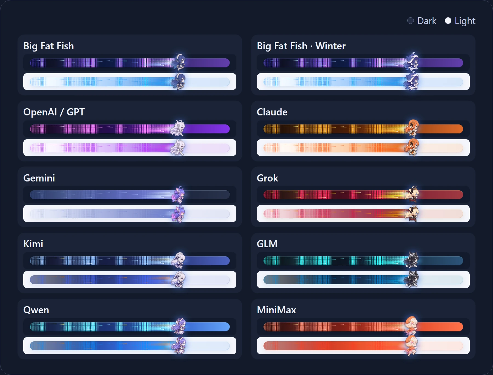
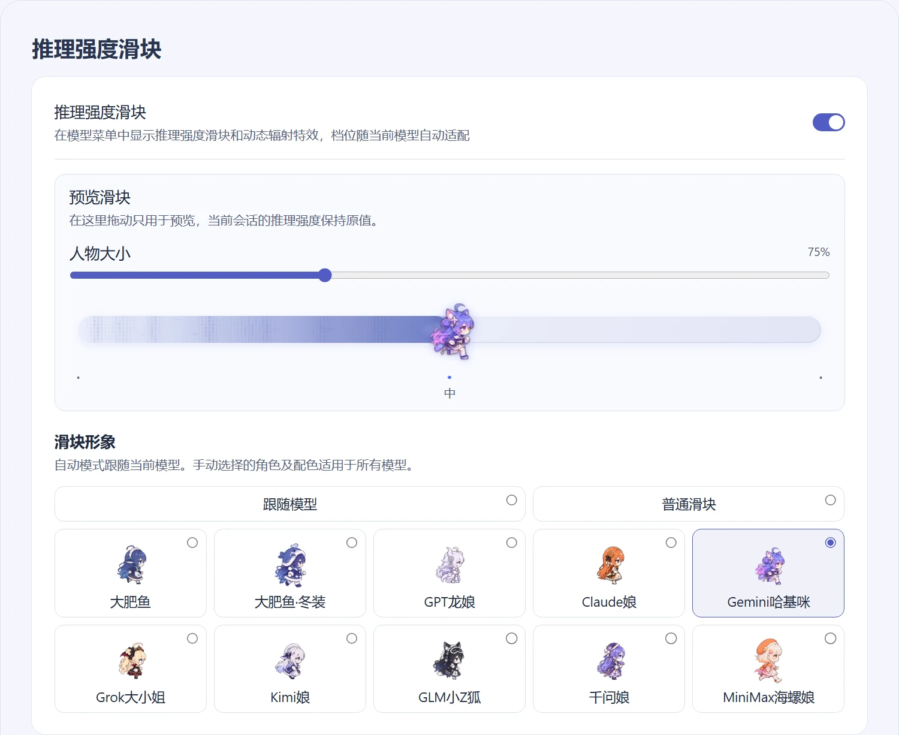

<p align="center">
  
</p>

<h1 align="center">dsh-reasoning-effort 1.0.0</h1>

<p align="center">在 <strong>DeepSeek Harness</strong> 的原生模型菜单里拖动调节推理强度。1.0.0 带来 <strong>9 个模型家族、10 个跑步形象</strong>，以及可以直接试拖的独立设置页。</p>

<p align="center">
  <a href="README.en.md">English</a> · <a href="#安装与更新">安装</a> · <a href="https://www.npmjs.com/package/@ayanehana/dsh-reasoning-effort">npm</a> · <a href="https://github.com/HanaAyane/dsh-reasoning-effort/releases">发行版</a> · <a href="https://github.com/HanaAyane/dsh-reasoning-effort/issues">反馈</a>
</p>

<p align="center">
  <a href="https://www.npmjs.com/package/@ayanehana/dsh-reasoning-effort"></a>
  <a href="https://www.npmjs.com/package/@ayanehana/dsh-reasoning-effort"></a>
</p>

## 角色与轨道

<p align="center">
  
</p>



从大肥鱼和冬装，到 GPT 龙娘、Claude 娘、Gemini 哈基咪、Grok 大小姐、Kimi 娘、GLM 小 Z 狐、千问娘和 MiniMax 海螺娘，每个形象都有 **16 帧**跑步动画。拖动时角色加速，轨道和拖尾随角色配色切换。

## 安装与更新

### Desktop

在 **插件 → 添加插件 → 包名或地址** 填入下面的包名，安装后按提示重新加载。

```text
@ayanehana/dsh-reasoning-effort@1.0.0
```

### Web

```powershell
dsh plugin --profile web add @ayanehana/dsh-reasoning-effort@1.0.0
```

安装后重启 DSH Web Host，再刷新页面。

## 调节推理强度

点击输入框下方的模型名，打开 **推理等级**，拖动或点击滑块选择当前模型支持的档位。按 `Esc` 返回模型菜单。模型搜索、分组和 Agent Teams 开关继续由 DSH 提供。切回某个模型时，插件会恢复它上次确认且仍受支持的档位。

## 自定义外观

在 **设置 → 推理强度滑块** 选择跟随模型、固定角色或普通滑块。人物大小可调至 **50%–125%**，50% 对应默认尺寸。试拖设置页里的预览滑块，会话的推理档位保持原值。



## 兼容性与自定义模型

- 兼容性维护以 DSH RC 版本为目标。原生菜单适配基线为 **DSH 0.2.2-rc.2**。
- 自定义模型缺少档位时，在 **设置 → 模型 → 编辑提供商 → 自定义设置 → 模型选项 → 推理等级**，按端点的 API 文档填写。

感谢 @xihucuyudaichi 为多模型滑块贡献初版精灵图。 [PR #9](https://github.com/HanaAyane/dsh-reasoning-effort/pull/9)

[更新记录](CHANGELOG.md) · [参与开发](CONTRIBUTING.md) · [MIT 许可证](LICENSE)
