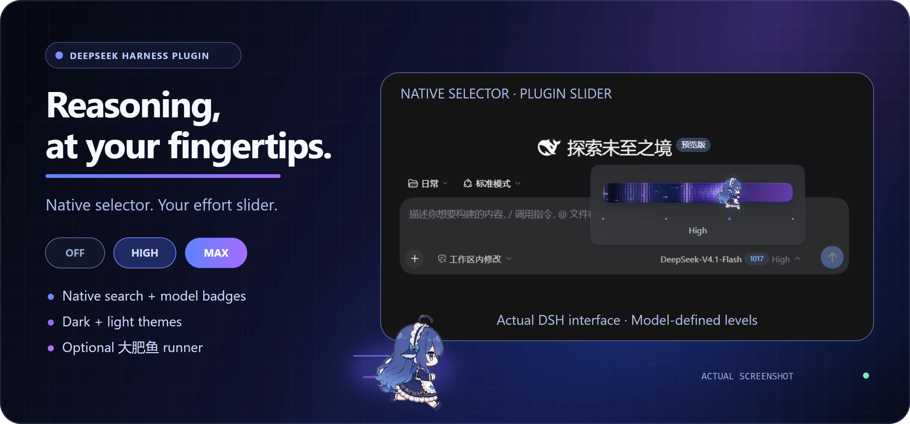

<div align="center">



# dsh-reasoning-effort

**沿用 DSH 原生模型选择器，在“推理等级”里拖动调节思考强度。**

[English](README.en.md) · [npm](https://www.npmjs.com/package/@ayanehana/dsh-reasoning-effort) · [最新发行版](https://github.com/HanaAyane/dsh-reasoning-effort/releases/latest) · [反馈问题](https://github.com/HanaAyane/dsh-reasoning-effort/issues)

[](https://github.com/HanaAyane/dsh-reasoning-effort/releases/tag/v0.9.3)
[](#版本支持政策)
[](LICENSE)
[](https://github.com/HanaAyane/dsh-reasoning-effort/releases)
[](https://www.npmjs.com/package/@ayanehana/dsh-reasoning-effort)

</div>

插件保留 DSH 的模型搜索、分组和 Agent Teams 开关，并记住每个模型上次选用的推理档位。


## 滑块形象

在 **设置 → 推理强度滑块** 中选择 **跟随模型**、**普通滑块**，或固定一个 Q 版形象供所有模型使用。轨道和拖尾使用所显示角色的配色，大肥鱼和大肥鱼·冬装共享同一套配色。普通滑块使用当前模型的配色。同一页也可以关闭插件滑块，恢复 DSH 原生模型菜单。

在同一页可以调整人物大小并拖动预览滑块。50% 对应默认大小，会话档位保持原值。

感谢 @xihucuyudaichi 为多模型滑块贡献初版精灵图。 [PR #9](https://github.com/HanaAyane/dsh-reasoning-effort/pull/9)

## 版本支持政策

插件 **`v0.9.3` 支持 DSH `0.2.2-rc.2`**。兼容性维护以 DSH RC 版本为目标。

## 安装与更新

### Web 版

在终端运行下面的命令，然后重启 DSH Web Host 并刷新网页。

```powershell
dsh plugin --profile web add @ayanehana/dsh-reasoning-effort@0.9.3
```

### Desktop 版

1. 在 DSH 桌面端打开 **插件 → 添加插件**。
2. 在 **包名或地址** 中填入 `@ayanehana/dsh-reasoning-effort@0.9.3`，点击安装。
3. 按应用提示重新加载。

## 使用方法

- 在会话输入框下方点击当前模型，再选 **推理等级**。拖动或点击滑块来选择档位，按 `Esc` 返回模型菜单。
- 如果自定义模型没有档位，可以到 **设置 → 模型 → 编辑提供商 → 自定义设置 → 模型选项 → 推理等级**，按模型 API 文档填写。

[更新记录](CHANGELOG.md) · [参与开发](CONTRIBUTING.md) · [MIT 许可证](LICENSE)
